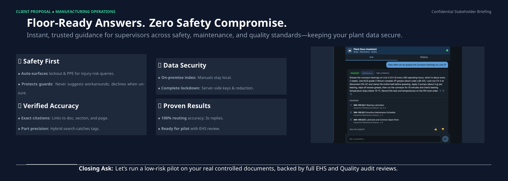

# plant-operation-manager

[](demo-and-requirements/1-Consulting_Pitch_One_Page_Final__deck.pdf)

## Live demo and video

- 🏠 **Home (Ops Now):** [https://plant-operation-manager.fly.dev/home](https://plant-operation-manager.fly.dev/home) (what it does, the 3 source PDFs, sample questions and a quick-ask chat in the corner)
- 🚀 **Live demo (full chat):** [https://plant-operation-manager.fly.dev](https://plant-operation-manager.fly.dev) (opens as demo user Carl Wayne; no setup needed)
- 📊 **Usage:** [https://plant-operation-manager.fly.dev/stats.html](https://plant-operation-manager.fly.dev/stats.html) (page views, unique visitors, questions and OpenAI cost per day)
- 🎬 **Video demo (1 min 15 s):** [https://www.youtube.com/watch?v=WV960Ni4jfc](https://www.youtube.com/watch?v=WV960Ni4jfc)
- 📋 **Requirements:** [the original challenge brief (PDF)](demo-and-requirements/AI%20Solution%20Prototype%20Challenge.pdf)

## Presentation speech

**Plant Docs Assistant · Consulting Pitch**

### Speaker Notes (What You Say to the Panel)

#### 1. Opening / Safety
*Addressing the Plant Manager & EHS Lead*

> "We know your top priority is keeping people safe on the floor. Supervisors are often caught between three different document sets, and hesitation or a wrong search can lead to injury or scrap. This system treats worker safety as a hard constraint: any query touching lockout, chemicals, or guards automatically pulls in safety procedures and warns supervisors before they act. If it's not in the docs, it refuses to guess."

#### 2. Security
*Addressing IT Security*

> "For IT security, your proprietary plant manuals and data never leave your control. All documents and the vector database reside on your local infrastructure. The browser never talks directly to the AI provider, and prompt-injection guardrails and automatic redaction ensure complete data protection and auditability."

#### 3. Accuracy & Trust
*Addressing the Quality Lead*

> "Every single answer includes clickable citations down to the exact section and page. Our hybrid search combines keyword precision with semantic understanding, matching the exact part numbers and valve tags your team uses every day, backed by a 100% routing accuracy in our test sets."

#### 4. Next Steps & Closing
*Closing the pitch*

> "It delivers answers in about three seconds for a fraction of a cent. Our path to production is straightforward: we are ready to deploy an initial pilot using your actual controlled documents, letting your EHS and Quality teams review every output against the full audit log, with enterprise SSO scheduled for wider rollout."

---

### Key Improvements Made for the Customer

- **Visual Hierarchy:** Replaced long paragraphs with punchy bullet points starting with bold action verbs/outcomes, making it immediately readable for busy executives.
- **Audience Alignment:** Grouped features directly to speak to the pain points of the four stakeholders (Plant Manager, EHS, IT Security, Quality).
- **Conversational Tone:** Shifted the speaker notes to sound like a confident, consultative advisor rather than an automated checklist reader.

## SOLUTION ARCHITECTURE FOR ACCURACY, SECURITY, SAFETY, GUARDRAILS AND AI GOVERNANCE

```
React + TypeScript (Vite)   →  FastAPI  →  LangGraph orchestrator
                                              ├─ Router agent      (gpt-4.1-mini)
                                              ├─ Retrieval agent   (hybrid: Chroma vectors + BM25)
                                              └─ Verifier agent    (gpt-4.1-mini)
Embeddings: text-embedding-3-small  ·  Vector DB: Chroma  ·  SQL: SQLite (queries, sessions, messages)
```

#### 1. LLM: OpenAI
- **`gpt-4.1-mini`** powers the router and verifier agents: fast, about $0.001 per answer, temperature 0 for consistent answers.
- **Strict JSON output** for every AI step, so responses can't drift into free-form text.
- One wrapper (`src/rag/llm.py`) handles every OpenAI call and tracks tokens, cost and latency.
- Swap models in `.env` (`CHAT_MODEL`, `EMBEDDING_MODEL`) without touching code.

#### 2. Embedding into the vector database (Chroma)
- `pypdf` reads the three plant PDFs. Each is split along its numbered sections into chunks of
  about 1,200 characters, with headers and footers removed.
- Each chunk keeps its document, section and page, so answers can cite the exact source.
- **`text-embedding-3-small`** turns each chunk into a vector. The full set costs about $0.0003.
- Stored locally in **Chroma** (`data/chroma/`), with one collection per source: safety (27), maintenance (33), quality (23).

#### 3. RAG: answering the query
- The question is embedded and matched against only the relevant document collections.
- The best passages (up to 8) are passed to the AI as numbered evidence.
- The answer is written **only from those passages**, never from the model's general knowledge.
- Every fact is cited by document, section and page, and the answer is withheld if no source supports it.

#### 4. Agentic AI: LangGraph agents
- An **orchestrator** runs three agents and searches all sources once if the first ones have no answer.
- **Router agent:** sends each question to safety, maintenance or quality, or declines or asks for
  clarification. Risky tasks always include safety procedures.
- **Retrieval agent:** searches the routed sources with hybrid search.
- **Verifier agent:** writes the cited answer, checks every claim and flags anything uncertain ("Check before acting").

#### 5. Hybrid search
- Combines **vector search** (meaning) with **BM25 keyword search** (exact words).
- The two rankings are merged with **Reciprocal Rank Fusion**, so passages ranked well by both rise to the top.
- Catches exact part numbers and tags like `HP-400`, `DS-3C` and `FE-400-10` that vector-only search misses.
- Finds the right section 100% of the time vs 94% for vector-only, and ranks it first 91% vs 78% (32 test questions).

#### 6. SQL: user sessions and audit log (SQLite)
- **`sessions`:** one conversation per ticket. Users see a ticket number (#1001, #1002, …) instead
  of the session ID, and a state: **Open** (the one active ticket), **On hold** (switched away from),
  **Escalated**, **Resolved** or **Closed**. Returning users get their last active ticket back.
- **Demo tickets:** on first run (empty `sessions` table) Carl Wayne gets five tickets, #1001 Open
  through #1005 Closed, with real agent answers from `src/persistence/demo_tickets.json`.
  Set `DEMO_TICKETS=0` to skip.
- **`session_messages`:** every question and answer in a session. Keys, emails and phone numbers are redacted before saving.
- **`queries`:** a full audit log of routes, citations, flags, confidence, cost and 👍/👎 feedback.
- Stored locally at `data/app.db`. Tables and columns are created or upgraded automatically on startup.

#### 7. Frontend: React with TypeScript
- **React 18 + TypeScript**, built with **Vite 5**, tested with Vitest (20 tests).
- Mobile-first, so it works on a phone on the same Wi-Fi, with light and dark mode.
- **Ask** screen with the signed-in customer (demo: Carl Wayne, read-only customer ID), the open
  ticket and its state (**Close ticket**, **New ticket**), cited answer cards and feedback.
  **History** screen with every other ticket and its state, each with **Reopen**.
- Calls FastAPI through a `/api` proxy, so the browser never talks to OpenAI directly.

#### 8. AI guardrails (safety & security)
- **Safety first:** risky tasks (lockout, guards, chemicals) always pull in safety procedures,
  and the supervisor gets a warning if an answer cites no safety source.
- **Prompt-injection guardrails:** questions and document text are treated as data, not
  instructions. A test attempt to override the rules was correctly refused.
- **API keys stay server-side** in `.env`, never in code or the browser.
- **No guessing:** out-of-scope questions are declined, and anything the documents don't cover gets "not found".
- **Grounded-answer checks:** code drops citations to passages that weren't retrieved, flags
  unsupported claims, and withholds any answer with no valid citation.
- **Privacy guardrail:** API keys, tokens, emails and phone numbers are redacted
  (`src/services/redact.py`) before questions and answers are saved to session history.

#### 9. Testing & evaluation
- **109 automated tests** (88 backend + 21 frontend), all mocked, so they run without an API key.
- **Answer eval** (18 questions, real API): 100% correct routing, citations and declines, and 17/18 pass overall.
- **Retrieval eval** (32 questions): hybrid search finds the right section 100% of the time vs 94% for vector-only, and ranks it first 91% vs 78%.
- About **3 seconds** and **$0.001** per answer (median 2.9 s, average $0.0013).

#### 10. AI governance
**In place today**
- **Audit trail:** every answer is logged in the `queries` table with its routes, citations,
  flags, confidence, cost and 👍/👎 feedback, so any answer can be traced and reviewed later.
- **Human in the loop:** answers are advisory. The supervisor decides, sees a **Check before
  acting** box for flags, and the app never takes actions (no work orders or quality holds).
- **Controlled sources:** answers come only from three controlled plant documents (EHS-SOP-001,
  MM-100, QC-STD-200), each cited by document, section and page.
- **Versioned prompts and models:** agent prompts live in `tools/prompts/` under git; models are
  set in one place (`CHAT_MODEL`, `EMBEDDING_MODEL`).
- **Data minimization:** session history is redacted before storage; keys stay server-side in `.env`.
- **Testing before release:** CI runs all mocked tests on every push; real-API answer and
  retrieval evals measure accuracy before changes are trusted.
- **Usage limits (cost control):** a daily OpenAI budget cap (`DAILY_BUDGET_USD`, default $1),
  per-visitor rate limits (5 questions a minute, 50 a day) and re-indexing switched off in the
  deployed app (`src/services/limits.py`).

**Planned before a wider rollout (not built yet)**
- Login and roles (supervisor vs. document owner), with per-user audit.
- Input moderation.
- A written AI-use policy and model card (intended use, limits, owners, review cadence).
- An eval gate in CI that blocks merges if accuracy drops.

## Run the app
You need Python 3.10+ (3.11 recommended), Node.js 18+ and your own OpenAI API key.

**1. Install (once)**
```bash
cd plant-operation-manager
python3.11 -m venv venv && source venv/bin/activate
pip install -r requirements.txt
cd frontend && npm install && cd ..
```

**2. Add your own LLM key (once)**

The app reads keys only from a local `.env` file in the project root. It's in `.gitignore`, so
it's never committed, and keys never reach the browser.
1. Create an API key at https://platform.openai.com/api-keys. Your OpenAI account needs billing
   enabled. A typical question costs about $0.001–0.002.
2. Copy the template and open it in an editor:
   ```bash
   cp .env.example .env
   ```
3. Set these two lines in `.env`:
   ```
   OPENAI_API_KEY=sk-your-key-here
   DATABASE_URL=sqlite:///data/app.db
   ```
4. Optional settings in `.env`:
   - `CHAT_MODEL`: the model for the router and verifier agents. Default `gpt-4.1-mini`.
   - `EMBEDDING_MODEL`: the embedding model. Default `text-embedding-3-small`. If you change it,
     rebuild the index (step 3).
   - `RETRIEVAL_MODE`: `hybrid` (default) or `vector`.

To change keys later, edit `.env` and restart the backend (step 4).

**3. Build the document index (once, about $0.0003)**

Reads the three plant PDFs in `docs/`, embeds them with your key, and stores them locally in
`data/chroma/`.
```bash
python tools/scripts/ingest_docs.py
```

**4. Run the web app (two terminals)**
```bash
# Terminal 1: backend (FastAPI and the LangGraph agents)
source venv/bin/activate
uvicorn main:app --reload --app-dir src

# Terminal 2: web UI
cd frontend
npm run dev          # this computer only: http://localhost:5173
npm run dev:phone    # or: also open the printed "Network" URL on a phone on the same Wi-Fi
```
Open the app. The dot in the header turns green when it's connected. Tap the sample question
*"How often do we grease the conveyor bearings on Line 3?"*. The answer should say **250
operating hours** and cite **MM-100 §4.1**.

**Or ask the LLM agents from the terminal (no web server needed)**
```bash
source venv/bin/activate
python tools/scripts/ask.py "What torque do the HP-400 die clamp bolts need?"
python tools/scripts/ask.py --trace "Can I replace a machine guard while the line is running?"
python tools/scripts/ask.py          # interactive mode; :quit to exit
```

**Troubleshooting**
| Message | Fix |
|---|---|
| `OPENAI_API_KEY is not set` | Add your key to `.env` (step 2), then restart the backend |
| `DATABASE_URL is not set` | Add `DATABASE_URL=sqlite:///data/app.db` to `.env` |
| `Incorrect API key` / `401` | The key is wrong or revoked. Create a new one and update `.env` |
| `insufficient_quota` / `429` | Add billing or credit to your OpenAI account |
| Red dot / "Can't reach the server" | Terminal 1 isn't running |
| "Document index isn't built yet" | Run step 3 |

More detail: [`docs/runbooks/mobile-app.md`](docs/runbooks/mobile-app.md) (web and phone),
[`docs/runbooks/cli.md`](docs/runbooks/cli.md) (command line) and
[`docs/runbooks/deploy-fly.md`](docs/runbooks/deploy-fly.md) (deploy to Fly.io).

---

## About the project

A question-answering assistant for manufacturing floor supervisors. A supervisor asks a question
in plain language, the system works out which body of plant documentation should answer it
(**safety procedures**, **maintenance manuals** or **quality control standards**), retrieves the
relevant passages and returns an accurate, cited answer.

> Status: requirements stage. The technical architecture is still to be decided. See
> [`docs/architecture.md`](docs/architecture.md).

## Problem
Floor supervisors need fast, correct answers during a shift: how to lock out a machine, what the
service interval is for a pump, what the acceptable tolerance is for a part. The answers exist,
but they're spread across separate document sets owned by different teams. Searching the wrong
set wastes time, and a wrong or outdated answer can cause injuries, equipment damage or scrap.

## Users
| User | Need |
|---|---|
| **Floor supervisor** (primary) | Ask a question mid-shift and get a short, trustworthy answer with the source. |
| **Plant operator / manager** | Make sure supervisors use the approved documentation, and see what's being asked. |
| **Document owners** (EHS, maintenance, QA) | Keep their document set current and know when answers relied on it. |

## Knowledge sources
| Source | Covers | Example question |
|---|---|---|
| **Safety procedures** | Lockout/tagout, PPE, hazardous materials, emergency response, permits | "What PPE do I need to clean the solvent tank?" |
| **Maintenance manuals** | Equipment operation, service intervals, troubleshooting, parts, torque specs | "How often do we grease the conveyor bearings on Line 3?" |
| **Quality control standards** | Specs and tolerances, inspection plans, sampling, nonconformance handling | "What's the acceptable diameter tolerance for part A-102?" |

Fictional sample documents for development live in `docs/`: `safety_procedures.pdf` (EHS-SOP-001),
`maintenance_manual.pdf` (MM-100) and `quality_control_standards.pdf` (QC-STD-200). To rebuild them, run
`python tools/scripts/generate_sample_docs.py` (needs `reportlab` and Python 3.10+).

## How it should work
1. **Ask:** the supervisor types a question.
2. **Route:** the system classifies the question to one source, or to more than one when it spans
   them (e.g. "Can I replace this guard while the line runs?" touches safety and maintenance).
3. **Retrieve:** it searches only the chosen source(s) for the relevant passages.
4. **Answer:** it writes a concise answer grounded only in those passages.
5. **Cite:** it shows which source was used, plus the document, section and page for each claim.
6. **Fall back:** if the question is ambiguous, out of scope or not covered by the documents, it
   says so (or asks a clarifying question) instead of guessing.

## Functional requirements
- **FR1 Routing:** classify each question to safety, maintenance, quality, several of these, or
  out of scope, and show the routing decision to the user.
- **FR2 Retrieval:** retrieve from the routed source(s) only.
- **FR3 Grounded answers:** answer only from retrieved content, never from general model
  knowledge.
- **FR4 Citations:** every answer cites its source documents (document name, section, page).
- **FR5 Safety priority:** when a question has any safety angle, include the relevant safety
  guidance, even if the main route is maintenance or quality.
- **FR6 Unknowns:** reply "not found in the documentation" rather than inventing an answer, and
  ask for clarification when the question is ambiguous (e.g. which machine or line).
- **FR7 Document ingestion:** load and re-index each document set (PDF and text) separately, so
  each source can be updated on its own.
- **FR8 Query log:** store questions, routes, answers and citations for review and evaluation.
- **FR9 Feedback:** let supervisors mark an answer helpful or not helpful.

## Non-functional requirements
- **Accuracy over fluency:** a short, correct, cited answer beats a long one.
- **Speed:** answers within a few seconds, usable on a shop-floor tablet.
- **Traceability:** every answer can be traced back to the passages it used.
- **Secrets:** API keys come from environment variables only (see `.env.example`).
- **Guardrails:** stay in scope, answer only from cited evidence, always include safety
  procedures for risky tasks, ignore instructions hidden in questions or documents, and redact
  personal data before storage.
- **AI governance:** every answer is logged and auditable, humans make the final call, prompts
  and models are versioned, and quality is measured by tests and evals before release.
- **Testability:** unit tests run fully mocked with no API key. Real-API checks live in
  `evaluation/`.

## Success criteria
| Metric | Target (initial) |
|---|---|
| Routing accuracy on a labelled question set | ≥ 90% |
| Answers with correct citations | ≥ 95% |
| Out-of-scope or uncovered questions correctly declined | ≥ 90% |
| Median response time | ≤ 5 s |

## Out of scope (first version)
- Writing or editing the documents themselves.
- Live machine data (sensors, MES or CMMS integrations).
- Taking actions such as opening work orders or quality holds.
- Multi-plant or multi-language support.

## Open questions for the architecture discussion
- Routing approach: LLM classifier, embedding similarity, rules or a hybrid, and how to handle
  multi-source questions.
- Index design: one vector store per source or one store with source metadata.
- Which UI comes first (React, Streamlit or Gradio).
- Sample documents: real plant documents, or synthetic ones for development.
- Whether the app needs auth and roles (supervisor vs. document owner).

## Stack (planned)
UI = React (Vite + TS), Streamlit, Gradio · Backend = FastAPI (Python) · Database = SQLite ·
LLM = OpenAI · Tests = pytest, vitest

## Setup
```bash
python3.11 -m venv venv && source venv/bin/activate   # Python 3.10+ required
pip install -r requirements.txt
cp .env.example .env   # then fill in values
cd frontend && npm install
```

## Build the vector store
Chunks the three PDFs in `docs/` by section, embeds them with OpenAI (`text-embedding-3-small`)
and stores them in a local Chroma database at `data/chroma/` (one collection per source:
`safety`, `maintenance`, `quality`). Re-running rebuilds the chosen collections.
```bash
python tools/scripts/ingest_docs.py                  # all sources
python tools/scripts/ingest_docs.py --source safety  # one source
python tools/scripts/ingest_docs.py --search "How often do we grease the CV-3 bearings?"
```
Code: `src/rag/` (`pdf_loader.py` chunking, `llm.py` OpenAI wrapper, `vector_store.py`, `ingest.py`).

Retrieval is **hybrid**: vector similarity plus BM25 keyword search, merged with Reciprocal Rank
Fusion (`src/rag/hybrid.py`). Keyword search catches exact IDs and part numbers (HP-400, DS-3C,
FE-400-10) that embeddings miss. Set `RETRIEVAL_MODE=vector` to compare against vector-only.

## Run
| Part | Command | URL |
|---|---|---|
| FastAPI backend | `uvicorn main:app --reload --app-dir src` | http://localhost:8000 (docs at `/docs`) |
| Streamlit UI | `streamlit run app.py` (path TBD) | http://localhost:8501 |
| Gradio UI | `python app.py` (path TBD) | http://localhost:7860 |
| React UI (mobile-friendly) | `cd frontend && npm run dev` (`npm run dev:phone` for phones on the same Wi-Fi) | http://localhost:5173 |

## React app (phone and desktop)
Mobile-first UI in `frontend/` for supervisors: ask questions, see cited answers with flags,
give feedback and browse history. It calls FastAPI through a `/api` proxy. Run the backend, then
`cd frontend && npm run dev:phone` and open the printed Network URL on a phone on the same Wi-Fi.
Full guide: [`docs/runbooks/mobile-app.md`](docs/runbooks/mobile-app.md).

## Ask from the command line
Runs the agents directly against the vector store, no server needed. Full guide:
[`docs/runbooks/cli.md`](docs/runbooks/cli.md).
```bash
source venv/bin/activate
python tools/scripts/ask.py "How often do we grease the conveyor bearings on Line 3?"
python tools/scripts/ask.py            # interactive mode (:trace, :quit)
python tools/scripts/ask.py --trace "..."   # show each agent's step
```

## API
The backend needs `OPENAI_API_KEY` and `DATABASE_URL` (e.g. `sqlite:///data/app.db`) in `.env`.

| Method | Path | Purpose |
|---|---|---|
| GET | `/health` | Status, whether the vector store is built, and whether the answer agent is ready |
| GET | `/sources` | The three document sources with their chunk counts |
| POST | `/sources/ingest` | Re-index all sources or chosen ones (`{"sources": ["safety"]}`) |
| POST | `/search` | Retrieval only: top chunks with citations (`{"question", "sources"?, "k"?}`) |
| POST | `/ask` | Routed, cited, verified answer from the LangGraph agent (status, routes, answer, citations, flags, confidence, trace), logged to SQLite |
| GET | `/queries`, `/queries/{id}` | Query log (FR8) |
| POST | `/queries/{id}/feedback` | Mark an answer helpful or not (FR9) |
| GET | `/sessions` | A customer's tickets with ticket number, state and question count |
| POST | `/sessions/active` | The last active ticket with its messages (`{"customer_id", "create"?}`; `create: false` returns null instead of opening one) |
| POST | `/sessions/new` | Open a new ticket; the open one goes on hold |
| POST | `/sessions/{id}/close`, `/sessions/{id}/resume` | Close a ticket, or reopen one as the active ticket |
| POST | `/visit` | Page-load ping from the UI for visitor counts (stores a salted daily hash, never the IP) |
| GET | `/stats` | Per-day page views, unique visitors, questions and OpenAI cost (`?days=30`); shown at `/stats.html` |

Layout: `src/main.py` (app) → `src/api/` (routes, schemas, dependencies) → `src/services/` → `src/persistence/`
(SQLite) and `src/rag/` (vector store). The agent plugs in through the `AnswerAgent` interface in
`src/agents/base.py`.

## Agents (LangGraph)
An orchestrator (`src/agents/orchestrator.py`) runs three subagents:
1. **Router** (`router.py`): classifies the question to safety, maintenance and/or quality, out of
   scope, or needs clarification. Safety-relevant questions always include the safety source.
2. **Retrieval** (`retrieval.py`): searches only the routed collections and returns numbered evidence.
3. **Response verification** (`verifier.py`): writes the answer from the evidence only, cites it,
   checks every citation and claim, and flags uncertainty.

If the routed sources have no answer, the orchestrator widens the search to all sources once.
Prompts live in `tools/prompts/`. See [`docs/architecture.md`](docs/architecture.md) for details.

## Test
- Python: `pytest`
- React: `cd frontend && npx vitest run` (build check: `npm run build`)
- Retrieval eval: `python evaluation/retrieval_eval.py` (32 cases; compares vector-only vs hybrid
  search: hit rate, top-1, MRR)
- Real-API evals: `python evaluation/run_evals.py` (18 cases in `evaluation/cases.jsonl`; scores
  routing, status, citations, key values and declines against the success criteria above)
